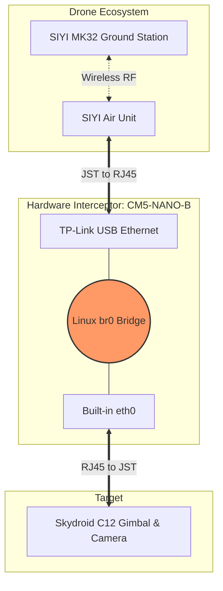

# PyGimbal-RP5: Skydroid & SIYI Reverse Engineering & Python SDK


A comprehensive Python library and hardware reference design for intercepting, decoding, and autonomously controlling the **Skydroid C12** gimbal and **SIYI MK32** ecosystem using a **Raspberry Pi 5**.

This project documents the entire journey of performing a hardware-level network bridge (Man-in-the-Middle), reverse-engineering proprietary UDP control packets, and building a modern SDK for autonomous gimbal tracking and AI vision processing (e.g., OpenCV, ROS 2 integration).

---

## 🏗️ Hardware Architecture (Network Bridge)

To reverse-engineer the proprietary communication between the SIYI Air Unit and the Skydroid Gimbal without packet loss, I designed a **Transparent Man-in-the-Middle (MitM) Ethernet Bridge** using the RPi 5.

### System Diagram


# Cheat Sheet: Skydroid / SIYI UDP Commands (Direct Mapping)

This file is a direct map showing exactly which string triggers which gimbal movement, and how to send these commands properly.

**Target:** `192.168.144.108`, Port: `5000` (UDP Protocol)

---

## ⚙️ How it works (Golden Rules)

1. **Velocity, not absolute position:** The gimbal does not accept commands like "rotate to 45 degrees". It takes commands like "rotate right at speed 80".
2. **Continuous Stream (Spamming):** Sending a movement command only once will cause a microscopic, almost invisible twitch. For continuous movement, **you must send the same command in a loop**:
   - Gimbal movement: every **50 ms** (~20 Hz).
   - Zoom: every **28 ms** (~35 Hz).
3. **Watchdog (Safety feature):** If you stop sending movement packets, the camera will automatically brake and stop after about 300 milliseconds.
4. **Checksums:** The last two characters of every command are the checksum. If you change even one character in the command, you must calculate a new checksum. The payloads below have their checksums hardcoded and ready to use.

---

## ↔️ Horizontal Axis (YAW)
*Send the chosen command continuously every 50 ms.*

| Exact Command | Action / Movement |
| :--- | :--- |
| `#TPUG2wGSY5064` | **FAST RIGHT** (speed +80) |
| `#TPUG2wGSY1464` | **SLOW RIGHT** (speed +20) |
| `#TPUG2wGSYB071` | **FAST LEFT** (speed -80) |
| `#TPUG2wGSYEC87` | **SLOW LEFT** (speed -20) |
| `#TPUG2wGSY005F` | **STOP (Horizontal)** - send once to halt immediately |

---

## ↕️ Vertical Axis (PITCH)
*Send the chosen command continuously every 50 ms.*

| Exact Command | Action / Movement |
| :--- | :--- |
| `#TPUG2wGSP505B` | **FAST UP** (speed +80) |
| `#TPUG2wGSP145B` | **SLOW UP** (speed +20) |
| `#TPUG2wGSPB068` | **FAST DOWN** (speed -80) |
| `#TPUG2wGSPEC7E` | **SLOW DOWN** (speed -20) |
| `#TPUG2wGSP0056` | **STOP (Vertical)** - send once to halt immediately |

*(To move diagonally, send both a YAW packet and a PITCH packet sequentially inside the same 50ms loop).*

---

## 🔍 Optics (ZOOM)
*Send the chosen command continuously every 28 ms.*

| Exact Command | Action / Movement |
| :--- | :--- |
| `#TPUD2wDZM0A65` | **Zoom IN** |
| `#TPUD2wDZM0B66` | **Zoom OUT** |

---

## 🎯 Position Presets & Camera (Single-Fire)
*Do NOT spam these commands. Send them only 1 time (or 2-3 times in a row just to ensure UDP delivery).*

| Exact Command | Action / Movement |
| :--- | :--- |
| `#TPUG2wPTZ056F` | **Center All.** Resets the gimbal to the center on both axes (Yaw=0, Pitch=0). |
| `#TPUG6wGAY00001012` | **Center Yaw Only.** Returns to the horizontal center but keeps the current pitch angle. |
| `#TPUG2wPTZ026C` | **Look Down.** Pitches the camera straight down at the ground (-90 degrees). |
| `#TPUD2wCAP013E\r\n` | **Take a Photo.** *(WARNING: this is the only command that requires `\r\n` newlines at the very end!)* |

---

## 🛠️ How to test via Linux console (e.g., on a Raspberry Pi)

You can use `netcat` (`nc`) and a simple bash loop to test these.

**Example: Rotate fast right for 1 second (20 loops x 50ms):**
```bash
for i in {1..20}; do
  printf '#TPUG2wGSY5064' | nc -u -w0 -p 5000 192.168.144.108 5000
  sleep 0.05
done
